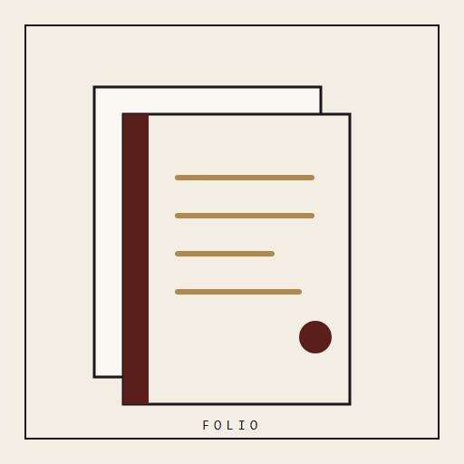
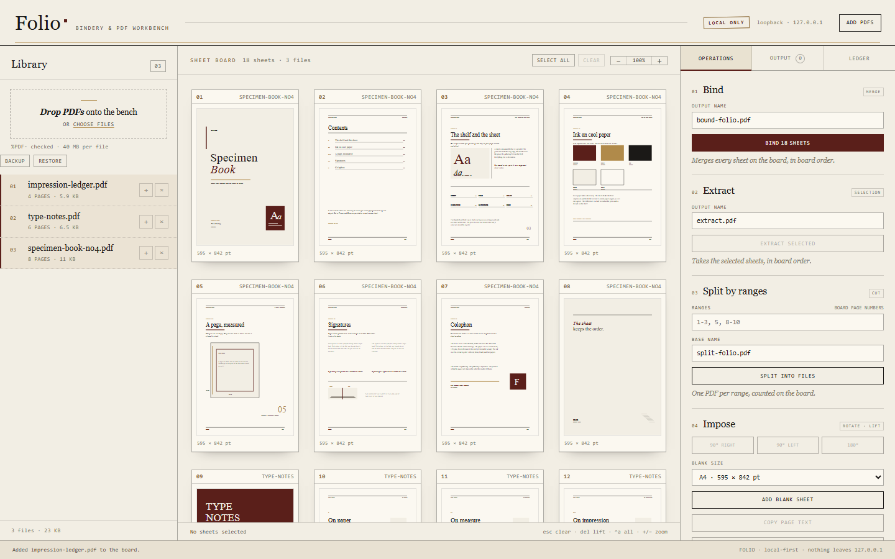
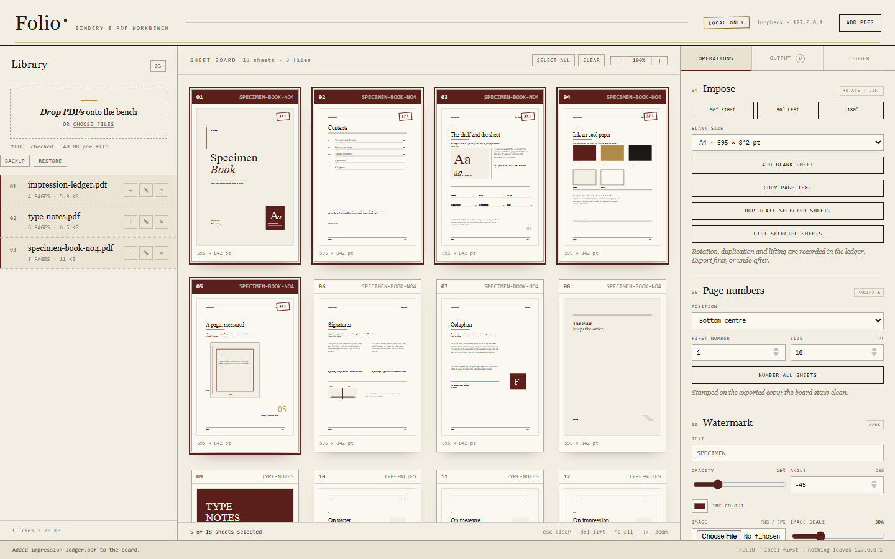
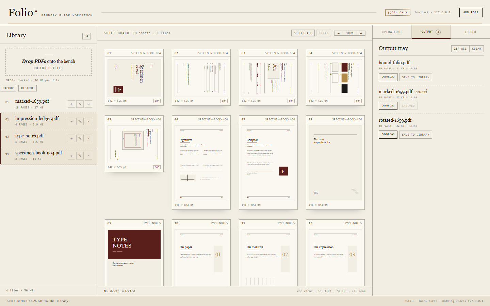

<div align="center">



# Folio

### Drop PDFs on the bench. Bind, split, rotate and number them — locally.

A private PDF workbench for Windows. No uploads, no account, no telemetry.

[](https://github.com/KHHH2312/folio/releases/latest)
[](https://github.com/KHHH2312/folio/releases)
[](#requirements)
[](LICENSE)



</div>

> **New — 1.1.0** — duplicate the selected sheets in place (Ctrl+D), undoable like every board edit.
> [Changelog →](CHANGELOG.md)

---

## Why Folio

**PDF chores are private.** Folio never uploads a page to a service or asks for an account.

**A page board beats a file picker.** You work with the sheets you can see, not blind range strings.

**Native output.** Text, page numbers and watermarks remain editable PDF content, not a flattened image.

## Features

| | |
|---|---|
| **Real page board** | Local PDF.js thumbnails of every sheet, selectable and reorderable. |
| **Bind & extract** | Merge the board in order, extract a selection, or split by ranges. |
| **Rotate, duplicate & lift** | Rotate, copy or remove sheets from a working copy with undo. |
| **Page numbers** | Position, start number and size, drawn as native PDF text. |
| **Watermark** | Text, colour, opacity and angle, applied to the working copy. |
| **Metadata** | Title, author and subject edited in place. |
| **Ledger** | Every operation recorded; results can be shelved into the library. |
| **Local only** | Loopback server, strict CSP, no telemetry and no remote assets. |

<div align="center">



</div>

## Requirements

- Windows 10 or 11, x64
- No account, no runtime install

## Install

1. Download **Folio-1.1.0-win32-x64.zip** from [Releases](https://github.com/KHHH2312/folio/releases/latest).
2. Verify it against `SHA256SUMS.txt`:
   ```powershell
   Get-FileHash .\Folio-*-win32-x64.zip -Algorithm SHA256
   ```
3. `FILEMANIFEST.txt` lists the SHA-256 and size of every file in the archive — diff it against what you unpacked.
4. Unzip anywhere and run **Folio.exe**.

> Self-signed development certificate: SmartScreen will warn until an OV/EV certificate is used.
> The SHA-256 checksum is the trust anchor.

## Using it

1. Install and launch Folio.
2. Drop PDFs on the left bench; their sheets appear on the board.
3. Select sheets, then use Bind, Extract, Split, Rotate, Duplicate, Watermark or Page numbers.
4. Download the result or shelve it back into the library.

## Verified

- PDF/API suite: 60 checks green.
- Browser end-to-end: 34 checks green, including sheet duplication and no non-loopback requests.
- Packaged app passes the source-parity integrity gate and is published with SHA-256 sums and a per-file manifest.

## Security and privacy

- Local-first: the app runs on loopback, stores data on your machine and sends no telemetry.
- Strict renderer policy, sandboxed window, denied navigation/window-open by default.
- Releases are integrity-gated, signed and published with SHA-256 sums and a per-file manifest.
- Found a flaw? Open a private security advisory instead of a public issue.

## FAQ

**Does it need an account?** No.

**Where is my data?** In the app's local data folder, not on a server.

**Why is the source not in this repository?** This repository distributes the application and its
documentation. The source is private.

## License

MIT — see [LICENSE](LICENSE). Third-party components in [THIRD-PARTY.md](THIRD-PARTY.md).

---

## The rest of the desk

Five local-first tools, one philosophy: your files, your machine, no telemetry.

- **Pressroom** — [deck studio](https://github.com/KHHH2312/pressroom)
- **Folio** — [PDF bindery](https://github.com/KHHH2312/folio)
- **Relay** — [API client](https://github.com/KHHH2312/relay)
- **Slate** — [markdown notebook](https://github.com/KHHH2312/slate)
- **Boardroom** — [whiteboard](https://github.com/KHHH2312/boardroom)
